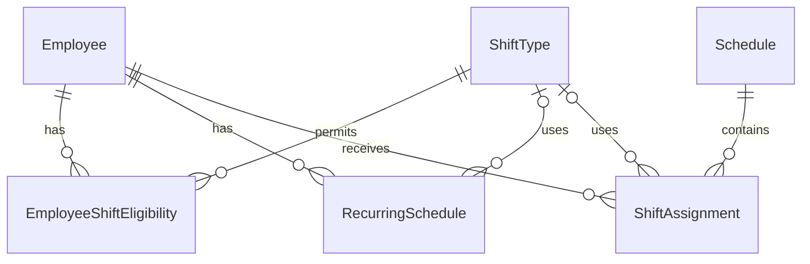

# StoreOps ERD

| 항목 | 내용 |
|---|---|
| 문서 버전 | v0.1 |
| 개발 대상 | 근무 스케줄 관리 모듈 |
| 문서 상태 | Draft (설계 검토 중) |

## 1. ERD

본 ERD는 StoreOps MVP의 근무 스케줄 관리 기능을 대상으로 한다.

초기에는 단일 매장을 기준으로 설계하며, 총 6개의 핵심 엔티티를 사용한다.

## 2. 테이블 정의

<!-- 테이블별 컬럼 및 제약조건 작성 예정 -->

## 3. 설계 검토 사항

### 3.1 확정 사항

- 직원 1명당 동일 근무 시작 날짜에 최대 1개의 근무 배정
- 근무 배정 상태를 WORK, OFF, 미배정으로 구분
- WORK와 OFF는 ShiftAssignment에 저장
- 미배정은 ShiftAssignment에 데이터가 없는 상태로 표현
- 야간 근무는 실제 시작 일시와 종료 일시를 저장하여 날짜 변경 처리

### 3.2 추가 검토 사항

- 고정 근무 패턴의 적용 기간 및 예외 처리
- 직원별 고정 근무 패턴 중복 방지
- 야간 근무와 다음 날 근무의 시간 중복 검증
- 다중 매장 지원을 위한 데이터 구조 확장
