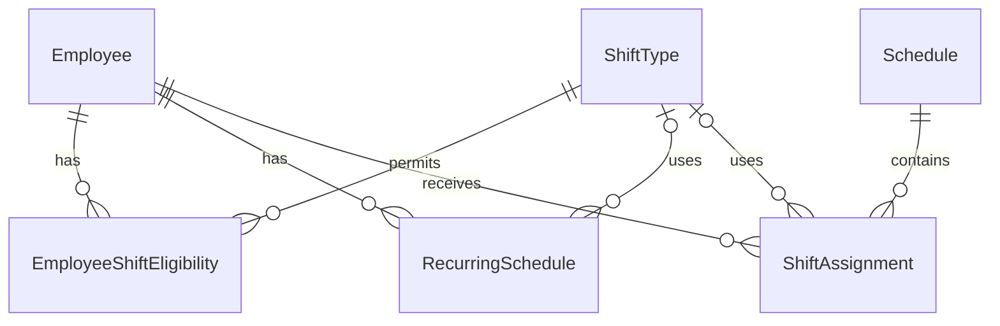

# StoreOps ERD

| 항목 | 내용 |
|---|---|
| 문서 버전 | v0.1 |
| 개발 대상 | 근무 스케줄 관리 모듈 |
| 문서 상태 | Draft (설계 검토 중) |

## 1. ERD

본 ERD는 StoreOps MVP의 근무 스케줄 관리 기능을 대상으로 한다.

초기에는 단일 매장을 기준으로 설계하며, 총 6개의 핵심 엔티티를 사용한다.

## 2. 테이블 정의

### 2.1 Employee (직원)

직원의 기본 정보, 고용 형태, 업무상 역할 및 재직 상태를 관리한다.

| 컬럼 | 자료형 | 제약조건 | 설명 |
|---|---|---|---|
| id | BIGINT | PK | 직원 고유 식별자 |
| name | VARCHAR(100) | NOT NULL | 직원 이름 |
| employment_type | VARCHAR(20) | NOT NULL | 고용 형태 |
| role | VARCHAR(30) | NOT NULL | 업무상 역할 |
| is_active | BOOLEAN | NOT NULL, DEFAULT TRUE | 재직 여부 |
| created_at | TIMESTAMP | NOT NULL | 등록 일시 |
| updated_at | TIMESTAMP | NOT NULL | 수정 일시 |

#### 고용 형태 (employment_type)

- FULL_TIME: 정규직 등 상시 근무 직원
- PART_TIME: 아르바이트

#### 업무상 역할 (role)

- STAFF: 일반 근무자
- SHIFT_LEADER: 근무조 운영 책임자
- MANAGER: 매장 관리자

#### 설계 원칙

- 고용 형태와 업무상 역할은 독립적으로 관리한다.
- 시프트리더는 PART_TIME 고용 형태를 가질 수 있다.
- 직원 비활성화 시 기존 근무 기록은 유지한다.
- 직원별 배정 가능한 근무조는 EmployeeShiftEligibility에서 별도로 관리한다.
- 실제 근무조별 책임자 지정 여부는 후속 개발에서 검토한다.

### 2.2 ShiftType (근무 유형)

매장에서 사용하는 근무 유형과 기본 시작 및 종료 시각을 관리한다.

| 컬럼 | 자료형 | 제약조건 | 설명 |
|---|---|---|---|
| id | BIGINT | PK | 근무 유형 식별자 |
| code | VARCHAR(30) | NOT NULL, UNIQUE | 근무 유형 코드 |
| name | VARCHAR(50) | NOT NULL | 근무 유형 이름 |
| start_time | TIME | NULL 허용 | 기본 시작 시각 |
| end_time | TIME | NULL 허용 | 기본 종료 시각 |
| is_active | BOOLEAN | NOT NULL, DEFAULT TRUE | 사용 여부 |

#### 기본 근무 유형

| 코드 | 이름 | 시작 시각 | 종료 시각 |
|---|---|---|---|
| OPEN | 오픈 | 07:00 | 16:00 |
| MIDDLE | 미들 | 11:00 | 20:00 |
| CLOSE | 마감 | 13:00 | 22:00 |
| NIGHT | 야간 | 22:00 | 07:00 (익일) |
| CUSTOM | 사용자 지정 | NULL | NULL |

#### 근무 시간 및 휴게 시간 관리 원칙

- 매니저와 시프트리더는 기본적으로 9시간 배정과 60분 휴게를 적용한다.
- 일반 아르바이트는 근무 시작 및 종료 시각을 자유롭게 지정할 수 있다.
- 일반 아르바이트의 휴게시간은 총 배정시간에 따라 자동 산정한다.
  - 4시간 미만: 0분
  - 4시간 이상 8시간 미만: 30분
  - 8시간 이상: 60분
- 실제 근로시간은 총 배정시간에서 휴게시간을 제외하여 계산한다.
- ShiftType에는 기본 휴게시간을 저장하지 않는다.
- 자동 산정된 휴게시간은 ShiftAssignment에 저장한다.
- 법정 최소 휴게시간 충족 여부는 실제 근로시간을 기준으로 별도 검증한다.
- 휴게시간은 근무 도중에 부여해야 한다.

#### 설계 원칙

- 근무 유형은 매장에서 사용하는 기본 근무시간을 정의한다.
- 일반 아르바이트는 근무 유형의 기본 시간과 다른 시간으로 배정할 수 있다.
- CUSTOM은 개별 근무시간을 지정하는 용도로 사용한다.
- 종료 시각이 시작 시각보다 이른 근무 유형은 익일 종료로 해석한다.
- 실제 근무 배정 시 시작 및 종료 일시를 ShiftAssignment에 저장한다.
- 근무 유형이 수정되어도 과거 근무 기록은 변경되지 않는다.
- 비활성화된 근무 유형은 신규 배정에서 제외하고 기존 기록은 유지한다.

## 3. 설계 검토 사항

### 3.1 확정 사항

- 직원 1명당 동일 근무 시작 날짜에 최대 1개의 근무 배정
- 근무 배정 상태를 WORK, OFF, 미배정으로 구분
- WORK와 OFF는 ShiftAssignment에 저장
- 미배정은 ShiftAssignment에 데이터가 없는 상태로 표현
- 야간 근무는 실제 시작 일시와 종료 일시를 저장하여 날짜 변경 처리

### 3.2 추가 검토 사항

- 고정 근무 패턴의 적용 기간 및 예외 처리
- 직원별 고정 근무 패턴 중복 방지
- 야간 근무와 다음 날 근무의 시간 중복 검증
- 다중 매장 지원을 위한 데이터 구조 확장
- 직원 역할별 기본 근무시간의 예외 처리
- 휴게시간 자동 산정 및 법정 기준 검증 방식
