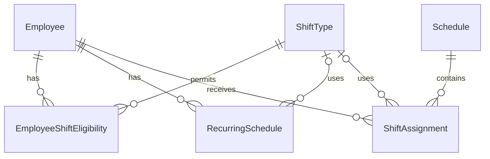

# StoreOps ERD

| 항목 | 내용 |
|---|---|
| 문서 버전 | v0.1 |
| 개발 대상 | 근무 스케줄 관리 모듈 |
| 문서 상태 | Draft (설계 검토 중) |

## 1. ERD

본 ERD는 StoreOps MVP의 근무 스케줄 관리 기능을 대상으로 한다.

초기에는 단일 매장을 기준으로 설계하며, 총 6개의 핵심 엔티티를 사용한다.

## 2. 테이블 정의

### 2.1 Employee (직원)

직원의 기본 정보, 고용 형태, 업무상 역할 및 재직 상태를 관리한다.

| 컬럼 | 자료형 | 제약조건 | 설명 |
|---|---|---|---|
| id | BIGINT | PK | 직원 고유 식별자 |
| name | VARCHAR(100) | NOT NULL | 직원 이름 |
| employment_type | VARCHAR(20) | NOT NULL | 고용 형태 |
| role | VARCHAR(30) | NOT NULL | 업무상 역할 |
| is_active | BOOLEAN | NOT NULL, DEFAULT TRUE | 재직 여부 |
| created_at | TIMESTAMP | NOT NULL | 등록 일시 |
| updated_at | TIMESTAMP | NOT NULL | 수정 일시 |

#### 고용 형태 (employment_type)

- FULL_TIME: 정규직 등 상시 근무 직원
- PART_TIME: 아르바이트

#### 업무상 역할 (role)

- STAFF: 일반 근무자
- SHIFT_LEADER: 근무조 운영 책임자
- MANAGER: 매장 관리자

#### 설계 원칙

- 고용 형태와 업무상 역할은 독립적으로 관리한다.
- 시프트리더는 PART_TIME 고용 형태를 가질 수 있다.
- 직원 비활성화 시 기존 근무 기록은 유지한다.
- 직원별 배정 가능한 근무조는 EmployeeShiftEligibility에서 별도로 관리한다.
- 실제 근무조별 책임자 지정 여부는 후속 개발에서 검토한다.

### 2.2 ShiftType (근무 유형)

매장에서 사용하는 근무 유형과 기본 시작 및 종료 시각을 관리한다.

<!-- TODO: ShiftType 테이블의 컬럼 및 제약조건 정의 -->

## 3. 설계 검토 사항

### 3.1 확정 사항

- 직원 1명당 동일 근무 시작 날짜에 최대 1개의 근무 배정
- 근무 배정 상태를 WORK, OFF, 미배정으로 구분
- WORK와 OFF는 ShiftAssignment에 저장
- 미배정은 ShiftAssignment에 데이터가 없는 상태로 표현
- 야간 근무는 실제 시작 일시와 종료 일시를 저장하여 날짜 변경 처리

### 3.2 추가 검토 사항

- 고정 근무 패턴의 적용 기간 및 예외 처리
- 직원별 고정 근무 패턴 중복 방지
- 야간 근무와 다음 날 근무의 시간 중복 검증
- 다중 매장 지원을 위한 데이터 구조 확장
